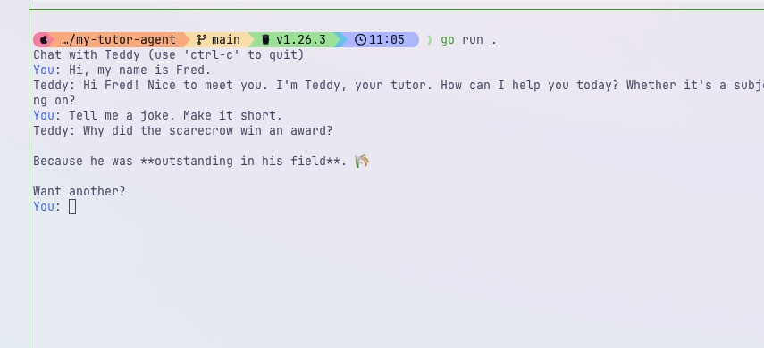
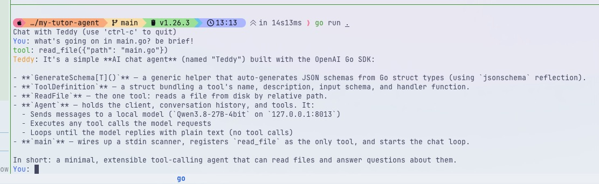

# my-tutor-agent

A simple CLI chat tutor ("Teddy") in Go, built on the OpenAI-compatible chat completions API.



## Requirements

- Go 1.26+
- An OpenAI-compatible endpoint (e.g. a local server exposing `/v1`)

## Usage

```bash
go run .
```

Then chat with Teddy in the terminal (`ctrl-c` to quit).

Configure the endpoint URL, API key, and model in `main.go` (see `openai.NewClient` and the `Model` field).

## v2: tool use

Teddy has a `read_file` tool. When you ask about a file, the model emits a tool
call, the agent runs it, appends the result as a `tool` message, and loops back
for a final answer.


Example session with `test.txt` (which contains `42`):

```text
Chat with Teddy (use 'ctrl-c' to quit)
You: read test.txt and print its contents
tool: read_file({"path":"test.txt"})
Teddy: test.txt contains:

42
```

What happens under the hood:

1. `user` message -> model responds with `tool_calls: [read_file{"path":"test.txt"}]`
2. agent executes `ReadFile`, appends `openai.ToolMessage("42\n", toolCallID)`
3. agent re-runs inference without asking for new user input
4. model returns plain text, agent prints it and prompts you again

### Reading its own source

Because `read_file` takes any relative path, Teddy can read and explain its own
code:



```text
You: what's going on in main.go? be brief!
tool: read_file({"path": "main.go"})
Teddy: It's a simple AI chat agent (named "Teddy") built with the OpenAI Go SDK...
```

To add your own tool: write an input struct, a `func(json.RawMessage) (string, error)`,
build a `ToolDefinition` with `GenerateSchema[YourInput]()`, and add it to the
`tools` slice in `main`.
